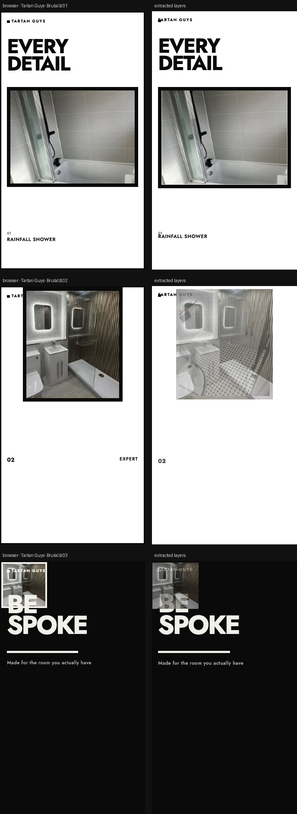

# Tartan Guys · Brutal

> Industrial. Heavy borders. Condensed type. No softness. High contrast. Aggressive scale. The bathrooms still look expensive — the frame does not.



**Source:** [`html-examples/02-brutal.html`](../../html-examples/02-brutal.html) · **Stages:** 3 · **Duration:** 9 s, 10 s, 11 s  
**Fixture:** [`tests/fixtures/examples/02-brutal.json`](../../tests/fixtures/examples/02-brutal.json) — Chrome at 1080 px, webfonts loaded  
**Layout:** measured in headless Chrome (`--layout measure`)

## Stages

| # | size | duration | layers | text | shapes | photos | text ≤2 % | paint |
|---|---|---|---|---|---|---|---|---|
| 1 | 1080×1920 | 9 s | 11 | 7 | 3 | 1 | 7/7 | 3/3 |
| 2 | 1080×1920 | 11 s | 18 | 10 | 2 | 6 | 4/4 | 7/7 |
| 3 | 1080×1920 | 10 s | 11 | 5 | 3 | 3 | 5/5 | 5/5 |

## How it was extracted

- 3 background layer(s) across all stages — a full-bleed photo with its pan/zoom keyframes, or the stage's own colour/gradient.
- 22 text layer(s) from measured content boxes; font, weight, colour, alignment and letter-spacing come from the computed style, and inline runs are merged into one layer.
- 8 shape layer(s) from background colour, borders, radius and per-side rules.
- 10 photo layer(s) placed at their cover/contain paint box; clipped ones are cropped to the visible window and CSS filters are baked in.
- Stage duration: 9 s, 10 s, 11 s; visibility uses the measured `data-s`/`data-e` windows (intersected with ancestors) with instant cuts.

## Design notes

Brutal. 3px black borders, zero radius, bold condensed type, fast hard cuts. White and pure black only. No gold, no yellow, no gentle fades.

## Known gaps

- The stacked bathroom photo frames are 2D-transformed layers; the photo is placed at its cover paint box, so the extracted frame can show a different crop/stack than the browser.
- The counter and frame transitions are sampled at 16 points; the CRT/scanline overlay is skipped as a texture.
- Decorative pseudo-elements (dots, halos, halftone overlays) are not measured; textual `::before` content is included.
- Text that the page injects from JS (live clocks, typed lines) is a snapshot from measurement time.

## Warnings

_None._

## Verify

```bash
python3 tools/audit-html-examples.py --only "02-brutal" --no-measure
python3 tools/check-html-parse.py --fixture tests/fixtures/examples/02-brutal.json \
  --html "html-examples/02-brutal.html" --verbose
```

