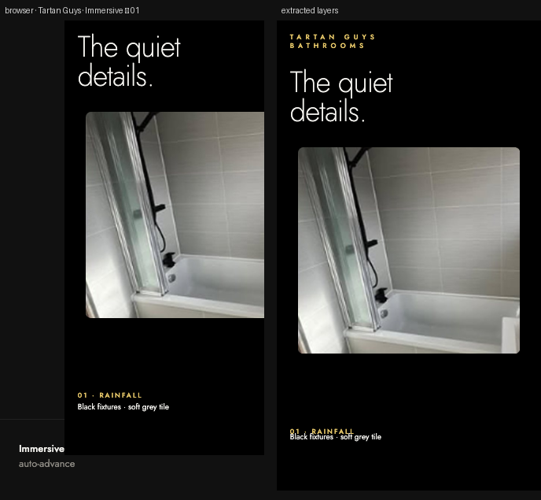

# Tartan Guys




**Source:** [`html-examples/03-immersive.html`](../../html-examples/03-immersive.html) · **Stages:** 1 · **Duration:** 12 s  
**Fixture:** [`tests/fixtures/examples/03-immersive.json`](../../tests/fixtures/examples/03-immersive.json) — Chrome at 1080 px, webfonts loaded  
**Layout:** measured in headless Chrome (`--layout measure`)

## Stages

| # | size | duration | layers | text | shapes | photos | text ≤2 % | paint |
|---|---|---|---|---|---|---|---|---|
| 1 | 1080×1920 | 12 s | 7 | 5 | 1 | 1 | 6/6 | 1/1 |

## How it was extracted

- 1 background layer(s) across all stages — a full-bleed photo with its pan/zoom keyframes, or the stage's own colour/gradient.
- 5 text layer(s) from measured content boxes; font, weight, colour, alignment and letter-spacing come from the computed style, and inline runs are merged into one layer.
- 1 shape layer(s) from background colour, borders, radius and per-side rules.
- 1 photo layer(s) placed at their cover/contain paint box; clipped ones are cropped to the visible window and CSS filters are baked in.
- Stage duration: 12 s; visibility uses the measured `data-s`/`data-e` windows (intersected with ancestors) with instant cuts.

## Design notes

_The page carries no notes block._

## Known gaps

- This is one stage with three auto-advancing chapters; the chapter DOM is rebuilt by the page's JS, so the composition reflects the sampled chapters and chapter-specific images can be placed at a different scale than the browser.
- Decorative pseudo-elements (dots, halos, halftone overlays) are not measured; textual `::before` content is included.
- Text that the page injects from JS (live clocks, typed lines) is a snapshot from measurement time.

## Warnings

_None._

## Verify

```bash
python3 tools/audit-html-examples.py --only "03-immersive" --no-measure
python3 tools/check-html-parse.py --fixture tests/fixtures/examples/03-immersive.json \
  --html "html-examples/03-immersive.html" --verbose
```

