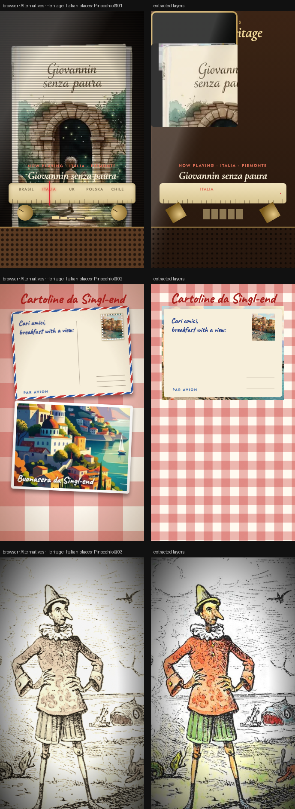

# Three alternatives, three new worlds

> One new 9:16 reel for each of your files, same context but a completely different look and motion.



**Source:** [`html-examples/Alternatives · Heritage · Italian places · Pinocchio.html`](../../html-examples/Alternatives · Heritage · Italian places · Pinocchio.html) · **Stages:** 3 · **Duration:** 12 s, 14 s  
**Fixture:** [`tests/fixtures/examples/alternatives-heritage-italian-places-pinocchio.json`](../../tests/fixtures/examples/alternatives-heritage-italian-places-pinocchio.json) — Chrome at 1080 px, webfonts loaded  
**Layout:** measured in headless Chrome (`--layout measure`)

## Stages

| # | size | duration | layers | text | shapes | photos | text ≤2 % | paint |
|---|---|---|---|---|---|---|---|---|
| 1 | 1080×1920 | 14 s | 65 | 19 | 41 | 5 | 19/19 | 40/40 |
| 2 | 1080×1920 | 12 s | 37 | 22 | 11 | 4 | 22/22 | 14/14 |
| 3 | 1080×1920 | 12 s | 25 | 9 | 10 | 6 | 9/9 | 13/13 |

## How it was extracted

- 3 background layer(s) across all stages — a full-bleed photo with its pan/zoom keyframes, or the stage's own colour/gradient.
- 50 text layer(s) from measured content boxes; font, weight, colour, alignment and letter-spacing come from the computed style, and inline runs are merged into one layer.
- 62 shape layer(s) from background colour, borders, radius and per-side rules, including 11 CSS gradient(s) rendered as SVG (linear, radial or tiled).
- 1 separate border rule(s) for borders that only exist on one side.
- 15 photo layer(s) placed at their cover/contain paint box; clipped ones are cropped to the visible window and CSS filters are baked in.
- JS-driven progress variables are set to their resting value before measuring: `--i1`, `--i2`, `--n`, `--nx`, `--p`.
- Stage duration: 12 s, 14 s; visibility uses the measured `data-s`/`data-e` windows (intersected with ancestors) with instant cuts.

## Design notes

The radio uses your five book covers (from your Heritage file) and its titles and regions; the copy line and URL are from your file. The postcards reuse the coastal photo and illustrated poster. The silent film reuses your Chiostri illustration and the wooden doll, and the dish and price (Scrambled eggs on toast, £8.50) are from the Singl-end menu. Taglines are mine, so edit them freely.

## Known gaps

- The first reel is a CRT-styled postcard rack: five full-bleed cover cards are clipped to the card window, so the extracted cover crop and paper card can differ from the browser; the CRT/scanline overlay is skipped as a texture.
- The second reel's letter and photo postcards are independent cards; the photo postcard can sit behind the letter in the flattened order.
- Decorative pseudo-elements (dots, halos, halftone overlays) are not measured; textual `::before` content is included.
- Text that the page injects from JS (live clocks, typed lines) is a snapshot from measurement time.

## Warnings

> Stage 3: Clipped image <div .abs gr> kept uncropped.

## Verify

```bash
python3 tools/audit-html-examples.py --only "Pinocchio" --no-measure
python3 tools/check-html-parse.py --fixture tests/fixtures/examples/alternatives-heritage-italian-places-pinocchio.json \
  --html "html-examples/Alternatives · Heritage · Italian places · Pinocchio.html" --verbose
```

