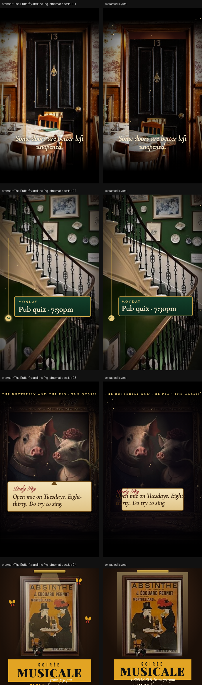

# The Butterfly and the Pig · cinematic posts

> Four posts built from your venue photos: a trailer through Door 13, a vertigo climb up the stairs, the gossip of the pig portrait, and a belle-époque soirée poster. All the listings come from your What’s On poster.



**Source:** [`html-examples/butterfly-pig-cinematic-posts.html`](../../html-examples/butterfly-pig-cinematic-posts.html) · **Stages:** 4 · **Duration:** 10 s, 14 s, 16 s  
**Fixture:** [`tests/fixtures/examples/butterfly-pig-cinematic-posts.json`](../../tests/fixtures/examples/butterfly-pig-cinematic-posts.json) — Chrome at 1080 px, webfonts loaded  
**Layout:** measured in headless Chrome (`--layout measure`)

## Stages

| # | size | duration | layers | text | shapes | photos | text ≤2 % | paint |
|---|---|---|---|---|---|---|---|---|
| 1 | 1080×1920 | 16 s | 65 | 24 | 38 | 3 | 24/24 | 8/8 |
| 2 | 1080×1920 | 14 s | 74 | 27 | 46 | 1 | 27/27 | 15/15 |
| 3 | 1080×1920 | 16 s | 66 | 15 | 50 | 1 | 15/15 | 6/6 |
| 4 | 1080×1350 | 10 s | 13 | 4 | 5 | 4 | 6/6 | 2/2 |

## How it was extracted

- 4 background layer(s) across all stages — a full-bleed photo with its pan/zoom keyframes, or the stage's own colour/gradient.
- 70 text layer(s) from measured content boxes; font, weight, colour, alignment and letter-spacing come from the computed style, and inline runs are merged into one layer.
- 139 shape layer(s) from background colour, borders, radius and per-side rules, including 47 CSS gradient(s) rendered as SVG (linear, radial or tiled).
- 7 separate border rule(s) for borders that only exist on one side.
- 9 photo layer(s) placed at their cover/contain paint box; clipped ones are cropped to the visible window and CSS filters are baked in.
- 3 inline-SVG artwork layer(s), rasterized in Chrome because the drawing cannot be expressed as editable boxes or type.
- JS-driven progress variables are set to their resting value before measuring: `--d`, `--p`, `--sx`, `--sy`.
- Stage duration: 10 s, 14 s, 16 s; visibility uses the measured `data-s`/`data-e` windows (intersected with ancestors) with instant cuts.

## Design notes

Times and events are transcribed from your What’s On poster (Mon pub quiz 7:30pm · Tue open mic 8:30pm · Wed jazz night 8:30pm with guest performers · Thu trad 8pm hosted by students RCS · Fri live music from 7:30pm · Sat live music from 6:30pm · Sun roast 12:30pm till sell out), so please check them against the current week. “Lord and Lady Pig”, the Door 13 story and the French touches are my own creative copy. The absinthe poster is a small image, so it’s shown at a modest size to stay sharp. In the door reel the door leaf is a cut-out of your photo that swings open in 3D; the portrait behind it is your pig photo.

## Known gaps

- The repeating-conic-gradient sunburst behind the Door 13 trailer is skipped: the CSS→SVG converter supports linear and radial gradients, not conic ones.
- The gossip reel is a stack of time-windowed quote cards; each card is a separate text + gradient layer with an instant cut at its `data-s`/`data-e`.
- The belle-époque poster is a flattened raster, so its fine print is not editable type.
- The SVG artwork is flattened: its type and illustration are not editable layers, and the stop-motion filters are frozen at the measured frame.
- Some gradient overlays could not be reproduced and were skipped (see the warnings below).
- Decorative pseudo-elements (dots, halos, halftone overlays) are not measured; textual `::before` content is included.
- Text that the page injects from JS (live clocks, typed lines) is a snapshot from measurement time.

## Warnings

> Stage 1: Gradient on <div .rr> is not supported; skipped.

## Verify

```bash
python3 tools/audit-html-examples.py --only "butterfly-pig-cinematic-posts" --no-measure
python3 tools/check-html-parse.py --fixture tests/fixtures/examples/butterfly-pig-cinematic-posts.json \
  --html "html-examples/butterfly-pig-cinematic-posts.html" --verbose
```

