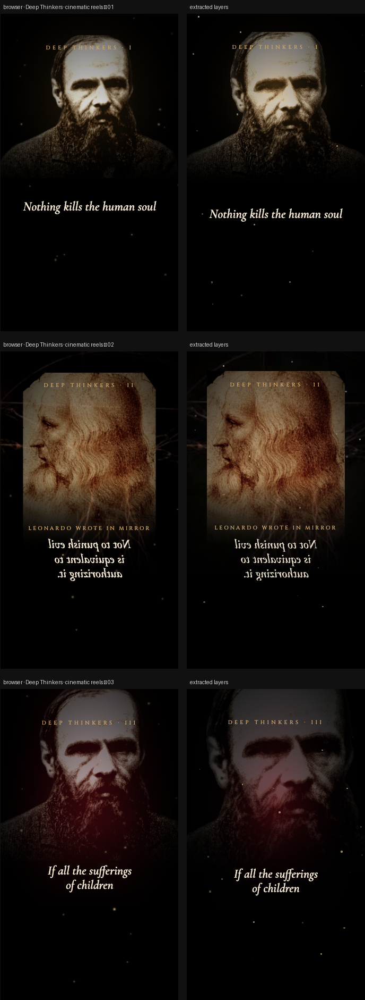

# Deep Thinkers · cinematic reels

> Three serious, dark 9:16 reels (15–18s, looping) built on the same engine as the Butterfly & Pig page. One thinker, one line, one slow reveal each.



**Source:** [`html-examples/Deep Thinkers · cinematic reels.html`](../../html-examples/Deep Thinkers · cinematic reels.html) · **Stages:** 3 · **Duration:** 15 s, 18 s  
**Fixture:** [`tests/fixtures/examples/deep-thinkers-cinematic-reels.json`](../../tests/fixtures/examples/deep-thinkers-cinematic-reels.json) — Chrome at 1080 px, webfonts loaded  
**Layout:** measured in headless Chrome (`--layout measure`)

## Stages

| # | size | duration | layers | text | shapes | photos | text ≤2 % | paint |
|---|---|---|---|---|---|---|---|---|
| 1 | 1080×1920 | 15 s | 30 | 5 | 24 | 1 | 7/7 | 1/1 |
| 2 | 1080×1920 | 15 s | 31 | 6 | 22 | 3 | 6/6 | 1/1 |
| 3 | 1080×1920 | 18 s | 32 | 7 | 24 | 1 | 8/8 | 2/2 |

## How it was extracted

- 3 background layer(s) across all stages — a full-bleed photo with its pan/zoom keyframes, or the stage's own colour/gradient.
- 18 text layer(s) from measured content boxes; font, weight, colour, alignment and letter-spacing come from the computed style, and inline runs are merged into one layer.
- 71 shape layer(s) from background colour, borders, radius and per-side rules, including 8 CSS gradient(s) rendered as SVG (linear, radial or tiled).
- 5 photo layer(s) placed at their cover/contain paint box; clipped ones are cropped to the visible window and CSS filters are baked in.
- 1 inline-SVG artwork layer(s), rasterized in Chrome because the drawing cannot be expressed as editable boxes or type.
- Stage duration: 15 s, 18 s; visibility uses the measured `data-s`/`data-e` windows (intersected with ancestors) with instant cuts.

## Design notes

Reel 2 shows the quote mirrored, like Leonardo’s notebooks, then flips it readable. Reel 3 is Ivan’s “rebellion” speech from The Brothers Karamazov; the other two lines are widely attributed to Dostoevsky and Leonardo but hard to source, so check them before posting if accuracy matters. To export, set the browser window so the reel is fully visible and screen-record it at 9:16; the dashed “Safe zones” box marks what Instagram/TikTok UI leaves clear.

## Known gaps

- The Leonardo quote is mirrored until 7 s; the mirrored state is a flattened raster and the live text takes over at the flip, so the 1.4 s transform is a cut rather than a tween.
- The red/amber glows use `mix-blend-mode: screen`; they are emitted as alpha gradients, so the light is approximated rather than blended.
- The floating dust motes are CSS animations sampled at 16 points; their motion is not keyframed.
- Portraits use `mask-image: linear-gradient(...)` fades; the linear fade is baked into the image, more complex masks are not.
- The SVG artwork is flattened: its type and illustration are not editable layers, and the stop-motion filters are frozen at the measured frame.
- Decorative pseudo-elements (dots, halos, halftone overlays) are not measured; textual `::before` content is included.
- Text that the page injects from JS (live clocks, typed lines) is a snapshot from measurement time.

## Warnings

_None._

## Verify

```bash
python3 tools/audit-html-examples.py --only "cinematic reels" --no-measure
python3 tools/check-html-parse.py --fixture tests/fixtures/examples/deep-thinkers-cinematic-reels.json \
  --html "html-examples/Deep Thinkers · cinematic reels.html" --verbose
```

