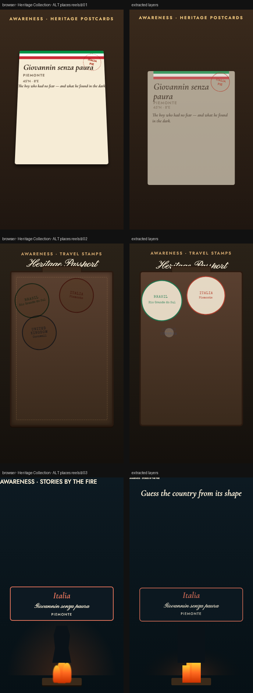

# Heritage Collection · ALT places reels

> Three new visual systems for the same five heritage stories: a flipping postcard rack, a suitcase filling with travel stamps, and a campfire storyteller with country shapes rising from the flames.



**Source:** [`html-examples/Heritage Collection · ALT places reels.html`](../../html-examples/Heritage Collection · ALT places reels.html) · **Stages:** 3 · **Duration:** 11.5 s, 13 s, 14.5 s  
**Fixture:** [`tests/fixtures/examples/heritage-collection-alt-places-reels.json`](../../tests/fixtures/examples/heritage-collection-alt-places-reels.json) — Chrome at 1080 px, webfonts loaded  
**Layout:** measured in headless Chrome (`--layout measure`)

## Stages

| # | size | duration | layers | text | shapes | photos | text ≤2 % | paint |
|---|---|---|---|---|---|---|---|---|
| 1 | 1080×1920 | 13 s | 46 | 28 | 18 | 0 | 27/28 | 12/12 |
| 2 | 1080×1920 | 11.5 s | 26 | 14 | 12 | 0 | 15/15 | 8/8 |
| 3 | 1080×1920 | 14.5 s | 28 | 18 | 9 | 1 | 6/6 | 4/4 |

## How it was extracted

- 3 background layer(s) across all stages — a full-bleed photo with its pan/zoom keyframes, or the stage's own colour/gradient.
- 60 text layer(s) from measured content boxes; font, weight, colour, alignment and letter-spacing come from the computed style, and inline runs are merged into one layer.
- 39 shape layer(s) from background colour, borders, radius and per-side rules, including 13 CSS gradient(s) rendered as SVG (linear, radial or tiled).
- 3 separate border rule(s) for borders that only exist on one side.
- 1 photo layer(s) placed at their cover/contain paint box; clipped ones are cropped to the visible window and CSS filters are baked in.
- 1 inline-SVG artwork layer(s), rasterized in Chrome because the drawing cannot be expressed as editable boxes or type.
- JS-driven progress variables are set to their resting value before measuring: `--p`.
- Stage duration: 11.5 s, 13 s, 14.5 s; visibility uses the measured `data-s`/`data-e` windows (intersected with ancestors) with instant cuts.

## Design notes

Same five places and stories as the original Heritage set. A is a physical postcard rack — cards rise and tilt toward the viewer one after another. B is an open suitcase that receives five circular travel stamps in sequence, ending with a “passport complete” mark. C is a night campfire scene: a silhouette storyteller, flickering flames, and country silhouettes that rise from the fire before the answer is revealed. All pure CSS/SVG + timeline JS. Durations are slightly longer than 10 s where the content needs it.

## Known gaps

- The first reel's postcard rack uses 3D transforms on five cards; the composition keeps the 2D card frames (the layer model has no perspective), so the card art can be blank and the stamps are placed at the measured 2D angle.
- The second reel fills a passport with stamps; the stamps' dashed borders and inner country art are separate rasters and can be scaled slightly differently.
- The SVG artwork is flattened: its type and illustration are not editable layers, and the stop-motion filters are frozen at the measured frame.
- Decorative pseudo-elements (dots, halos, halftone overlays) are not measured; textual `::before` content is included.
- Text that the page injects from JS (live clocks, typed lines) is a snapshot from measurement time.

## Warnings

_None._

## Verify

```bash
python3 tools/audit-html-examples.py --only "ALT places reels" --no-measure
python3 tools/check-html-parse.py --fixture tests/fixtures/examples/heritage-collection-alt-places-reels.json \
  --html "html-examples/Heritage Collection · ALT places reels.html" --verbose
```

