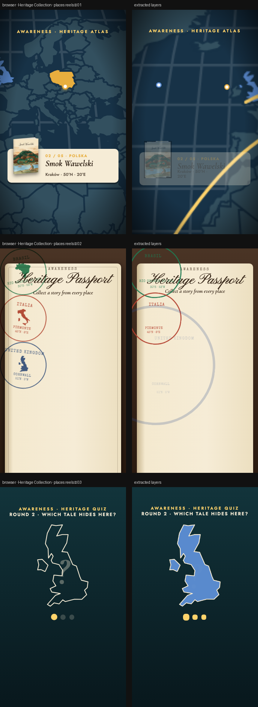

# Heritage Collection · places reels

> Three different 9:16 reels built on the book locations: a camera flight over the world map, a heritage passport and a guess-the-country quiz.



**Source:** [`html-examples/Heritage Collection · places reels.html`](../../html-examples/Heritage Collection · places reels.html) · **Stages:** 3 · **Duration:** 11 s, 13.5 s, 14.2 s  
**Fixture:** [`tests/fixtures/examples/heritage-collection-places-reels.json`](../../tests/fixtures/examples/heritage-collection-places-reels.json) — Chrome at 1080 px, webfonts loaded  
**Layout:** measured in headless Chrome (`--layout measure`)

## Stages

| # | size | duration | layers | text | shapes | photos | text ≤2 % | paint |
|---|---|---|---|---|---|---|---|---|
| 1 | 1080×1920 | 13.5 s | 51 | 20 | 14 | 17 | 20/20 | 17/17 |
| 2 | 1080×1920 | 11 s | 34 | 21 | 8 | 5 | 21/21 | 6/6 |
| 3 | 1080×1920 | 14.2 s | 83 | 29 | 17 | 37 | 29/29 | 21/21 |

## How it was extracted

- 3 background layer(s) across all stages — a full-bleed photo with its pan/zoom keyframes, or the stage's own colour/gradient.
- 70 text layer(s) from measured content boxes; font, weight, colour, alignment and letter-spacing come from the computed style, and inline runs are merged into one layer.
- 39 shape layer(s) from background colour, borders, radius and per-side rules, including 5 CSS gradient(s) rendered as SVG (linear, radial or tiled).
- 59 photo layer(s) placed at their cover/contain paint box; clipped ones are cropped to the visible window and CSS filters are baked in.
- 49 inline-SVG artwork layer(s), rasterized in Chrome because the drawing cannot be expressed as editable boxes or type.
- JS-driven progress variables are set to their resting value before measuring: `--p`.
- Stage duration: 11 s, 13.5 s, 14.2 s; visibility uses the measured `data-s`/`data-e` windows (intersected with ancestors) with instant cuts.

## Design notes

Maps and country shapes are drawn from public Natural Earth data (110m, simplified). Pins mark the regions on the covers: Rio Grande do Sul, Piemonte, Cornwall (Tintagel) and Kraków; Chile is pinned loosely because the cover shows no region, and its title is still a placeholder. Coordinates are approximate. Copy lives in the C object at the top of the script.

## Known gaps

- The map flight and the quiz reveal are SVG drawings; the two largest animated SVGs per stage are sample-rendered into 12-frame flipbooks, so those drawings step every ~0.8 s rather than moving continuously.
- The passport stamps are rotated containers with a separate country raster; their frame and silhouette are placed at the measured angle.
- The SVG artwork is flattened: its type and illustration are not editable layers, and the stop-motion filters are frozen at the measured frame.
- Decorative pseudo-elements (dots, halos, halftone overlays) are not measured; textual `::before` content is included.
- Text that the page injects from JS (live clocks, typed lines) is a snapshot from measurement time.

## Warnings

_None._

## Verify

```bash
python3 tools/audit-html-examples.py --only "places reels" --no-measure
python3 tools/check-html-parse.py --fixture tests/fixtures/examples/heritage-collection-places-reels.json \
  --html "html-examples/Heritage Collection · places reels.html" --verbose
```

