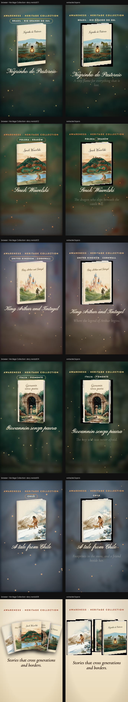

# Heritage Collection · story reels

> Six 10-second 9:16 reels: one per book plus the collection. Each is built from your covers; use Full screen to screen-record at 1080×1920.



**Source:** [`html-examples/Heritage Collection · story reels.html`](../../html-examples/Heritage Collection · story reels.html) · **Stages:** 6 · **Duration:** 10 s  
**Fixture:** [`tests/fixtures/examples/heritage-collection-story-reels.json`](../../tests/fixtures/examples/heritage-collection-story-reels.json) — Chrome at 1080 px, webfonts loaded  
**Layout:** measured in headless Chrome (`--layout measure`)

## Stages

| # | size | duration | layers | text | shapes | photos | text ≤2 % | paint |
|---|---|---|---|---|---|---|---|---|
| 1 | 1080×1920 | 10 s | 40 | 7 | 31 | 2 | 7/7 | 3/3 |
| 2 | 1080×1920 | 10 s | 40 | 7 | 31 | 2 | 7/7 | 3/3 |
| 3 | 1080×1920 | 10 s | 40 | 7 | 31 | 2 | 7/7 | 3/3 |
| 4 | 1080×1920 | 10 s | 40 | 7 | 31 | 2 | 7/7 | 3/3 |
| 5 | 1080×1920 | 10 s | 40 | 7 | 31 | 2 | 7/7 | 3/3 |
| 6 | 1080×1920 | 10 s | 17 | 9 | 3 | 5 | 9/9 | 6/6 |

## How it was extracted

- 6 background layer(s) across all stages — a full-bleed photo with its pan/zoom keyframes, or the stage's own colour/gradient.
- 44 text layer(s) from measured content boxes; font, weight, colour, alignment and letter-spacing come from the computed style, and inline runs are merged into one layer.
- 155 shape layer(s) from background colour, borders, radius and per-side rules, including 17 CSS gradient(s) rendered as SVG (linear, radial or tiled).
- 15 photo layer(s) placed at their cover/contain paint box; clipped ones are cropped to the visible window and CSS filters are baked in.
- JS-driven progress variables are set to their resting value before measuring: `--p`, `--s`.
- Reel length comes from the page's own `D = 10000` constant.
- Stage duration: 10 s; visibility uses the measured `data-s`/`data-e` windows (intersected with ancestors) with instant cuts.

## Design notes

All copy lives in the B array at the top of the script, so you can edit headlines in one place. The Chile cover has no title, so its reel uses the placeholder “A tale from Chile”: replace it with the real title. The “January 2027” line comes from your FAQ (first deliveries). Dashed safe zones keep text clear of Instagram/TikTok interface elements.

## Known gaps

- The book covers float and tilt with a long CSS animation; the layers keep the resting transform measured at the end of the reel.
- The blurred backdrop art (`filter: blur(25.92px) saturate(1.2)` at 32 % over `mix-blend-mode:screen`) is baked into the image; the blend mode itself is approximated.
- Decorative pseudo-elements (dots, halos, halftone overlays) are not measured; textual `::before` content is included.
- Text that the page injects from JS (live clocks, typed lines) is a snapshot from measurement time.

## Warnings

_None._

## Verify

```bash
python3 tools/audit-html-examples.py --only "story reels" --no-measure
python3 tools/check-html-parse.py --fixture tests/fixtures/examples/heritage-collection-story-reels.json \
  --html "html-examples/Heritage Collection · story reels.html" --verbose
```

