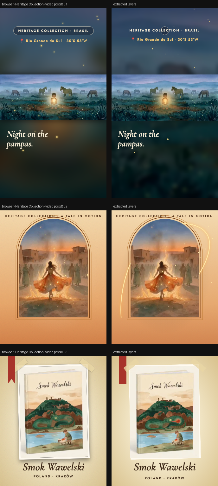

# Heritage Collection · video posts

> Three posting variations built on your book videos. The overlays follow each video’s own timeline, so they stay in sync when it loops.



**Source:** [`html-examples/Heritage Collection · video posts.html`](../../html-examples/Heritage Collection · video posts.html) · **Stages:** 3 · **Duration:** 4.9 s, 10 s  
**Fixture:** [`tests/fixtures/examples/heritage-collection-video-posts.json`](../../tests/fixtures/examples/heritage-collection-video-posts.json) — Chrome at 1080 px, webfonts loaded  
**Layout:** measured in headless Chrome (`--layout measure`)

## Stages

| # | size | duration | layers | text | shapes | photos | text ≤2 % | paint |
|---|---|---|---|---|---|---|---|---|
| 1 | 1080×1920 | 4.9 s | 33 | 8 | 22 | 3 | 8/8 | 3/3 |
| 2 | 1080×1350 | 10 s | 22 | 4 | 16 | 2 | 4/4 | 2/2 |
| 3 | 1080×1350 | 4.9 s | 28 | 5 | 22 | 1 | 5/5 | 5/5 |

## How it was extracted

- 3 background layer(s) across all stages — a full-bleed photo with its pan/zoom keyframes, or the stage's own colour/gradient.
- 17 text layer(s) from measured content boxes; font, weight, colour, alignment and letter-spacing come from the computed style, and inline runs are merged into one layer.
- 60 shape layer(s) from background colour, borders, radius and per-side rules, including 3 CSS gradient(s) rendered as SVG (linear, radial or tiled).
- 6 photo layer(s) placed at their cover/contain paint box; clipped ones are cropped to the visible window and CSS filters are baked in.
- 1 inline-SVG artwork layer(s), rasterized in Chrome because the drawing cannot be expressed as editable boxes or type.
- JS-driven progress variables are set to their resting value before measuring: `--ar`, `--p`, `--rb`.
- Stage duration: 4.9 s, 10 s; visibility uses the measured `data-s`/`data-e` windows (intersected with ancestors) with instant cuts.

## Design notes

(1) The dancer clip’s file reports 12.1s but only about 8.2s of it plays (the file looks cut off), so this version uses what plays; re-export it if you want the full length. (2) The dancer clip is cropped to a vertical frame here. All the original clips carry a small “AI” badge in the bottom-right corner, so please keep your platform’s AI-content label turned on when you post. (3) The dancer’s title, country and region are placeholders: click the text on the post to type your own. (4) Copy lines (“Light a candle. Find what was lost.”, “A dragon under the castle. One clever shepherd.”) are mine, so check them against the books. (5) Clips 1 and 2 include their original audio; use the Sound button to preview.

## Known gaps

- The four videos are embedded as a captured first frame (a poster), not as video layers; video motion, audio and blend modes are not part of the composition. The overlays are keyframed from the video's own timeline.
- The poster is captured at the measurement moment, so the browser-vs-extracted image can show a different video frame.
- The SVG artwork is flattened: its type and illustration are not editable layers, and the stop-motion filters are frozen at the measured frame.
- Decorative pseudo-elements (dots, halos, halftone overlays) are not measured; textual `::before` content is included.
- Text that the page injects from JS (live clocks, typed lines) is a snapshot from measurement time.

## Warnings

_None._

## Verify

```bash
python3 tools/audit-html-examples.py --only "video posts" --no-measure
python3 tools/check-html-parse.py --fixture tests/fixtures/examples/heritage-collection-video-posts.json \
  --html "html-examples/Heritage Collection · video posts.html" --verbose
```

