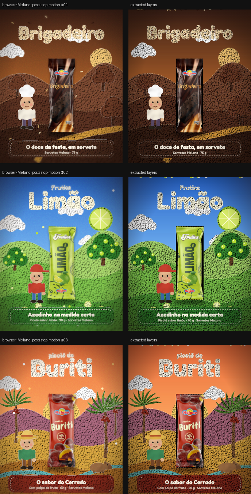

# Melano · posts stop-motion

> Three 4:5 posts, one per product, in a hand-made felt-and-clay miniature look: wool textures, stitched edges, stepped “stop-motion” movement and a tilt-shift lens.



**Source:** [`html-examples/Melano · stop-motion style posts.html`](../../html-examples/Melano · stop-motion style posts.html) · **Stages:** 3 · **Duration:** 10 s  
**Fixture:** [`tests/fixtures/examples/melano-stop-motion-style-posts.json`](../../tests/fixtures/examples/melano-stop-motion-style-posts.json) — Chrome at 1080 px, webfonts loaded  
**Layout:** measured in headless Chrome (`--layout measure`)

## Stages

| # | size | duration | layers | text | shapes | photos | text ≤2 % | paint |
|---|---|---|---|---|---|---|---|---|
| 1 | 1080×1350 | 10 s | 4 | 0 | 1 | 3 | 0/4 (baked) | 1/1 |
| 2 | 1080×1350 | 10 s | 4 | 0 | 1 | 3 | 0/6 (baked) | 1/1 |
| 3 | 1080×1350 | 10 s | 4 | 0 | 1 | 3 | 0/6 (baked) | 1/1 |

## How it was extracted

- 3 background layer(s) across all stages — a full-bleed photo with its pan/zoom keyframes, or the stage's own colour/gradient.
- 3 shape layer(s) from background colour, borders, radius and per-side rules, including 3 CSS gradient(s) rendered as SVG (linear, radial or tiled).
- 9 photo layer(s) placed at their cover/contain paint box; clipped ones are cropped to the visible window and CSS filters are baked in.
- 3 inline-SVG artwork layer(s), rasterized in Chrome because the drawing cannot be expressed as editable boxes or type.
- Stage duration: 10 s; visibility uses the measured `data-s`/`data-e` windows (intersected with ancestors) with instant cuts.

## Design notes

your screenshot was used only as a style reference (tactile miniature world, wool clouds, tiny characters, soft lighting). Everything is drawn from scratch, and I left out the video’s on-screen credits. The product art is your photos. Only facts from the packs are used (weights, “com polpa da fruta”, “sabor limão”); the slogans are my own copy in Portuguese, so adjust them to your voice. The wobbly “boiling” texture is animated at ~8 frames per second to mimic stop-motion.

## Known gaps

- The SVG scene is one flattened layer; the HTML product photo (`.pd`) can sit a few pixels off the drawn package, and the felt/clay stop-motion jitter is frozen.
- The SVG artwork is flattened: its type and illustration are not editable layers, and the stop-motion filters are frozen at the measured frame.
- Entry/exit motion (slide, scale, spin) is represented by visibility windows and the background pan, not by the authored transitions.
- Decorative pseudo-elements (dots, halos, halftone overlays) are not measured; textual `::before` content is included.
- Text that the page injects from JS (live clocks, typed lines) is a snapshot from measurement time.

## Warnings

> Stage 1: Text is baked into the flattened artwork layer (inline SVG).
> Stage 2: Text is baked into the flattened artwork layer (inline SVG).
> Stage 3: Text is baked into the flattened artwork layer (inline SVG).

## Verify

```bash
python3 tools/audit-html-examples.py --only "stop-motion style posts" --no-measure
python3 tools/check-html-parse.py --fixture tests/fixtures/examples/melano-stop-motion-style-posts.json \
  --html "html-examples/Melano · stop-motion style posts.html" --verbose
```

