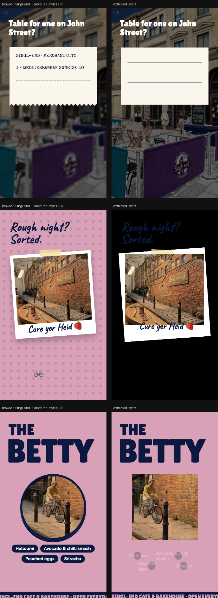

# Singl-end · 3 more reel styles

> Three very different 10-second 9:16 directions, using different menu items. Use Safe zones to check Instagram’s overlay areas.



**Source:** [`html-examples/Singl-end · 3 more reel styles.html`](../../html-examples/Singl-end · 3 more reel styles.html) · **Stages:** 3 · **Duration:** 10 s  
**Fixture:** [`tests/fixtures/examples/singl-end-3-more-reel-styles.json`](../../tests/fixtures/examples/singl-end-3-more-reel-styles.json) — Chrome at 1080 px, webfonts loaded  
**Layout:** measured in headless Chrome (`--layout measure`)

## Stages

| # | size | duration | layers | text | shapes | photos | text ≤2 % | paint |
|---|---|---|---|---|---|---|---|---|
| 1 | 1080×1920 | 10 s | 7 | 2 | 4 | 1 | 2/2 | 4/4 |
| 2 | 1080×1920 | 10 s | 9 | 4 | 4 | 1 | 4/4 | 4/4 |
| 3 | 1080×1920 | 10 s | 16 | 8 | 7 | 1 | 8/8 | 7/7 |

## How it was extracted

- 3 background layer(s) across all stages — a full-bleed photo with its pan/zoom keyframes, or the stage's own colour/gradient.
- 14 text layer(s) from measured content boxes; font, weight, colour, alignment and letter-spacing come from the computed style, and inline runs are merged into one layer.
- 15 shape layer(s) from background colour, borders, radius and per-side rules, including 1 CSS gradient(s) rendered as SVG (linear, radial or tiled).
- 2 separate border rule(s) for borders that only exist on one side.
- 3 photo layer(s) placed at their cover/contain paint box; clipped ones are cropped to the visible window and CSS filters are baked in.
- JS-driven progress variables are set to their resting value before measuring: `--p`.
- Reel length comes from the page's own `D = 10000` constant.
- Stage duration: 10 s; visibility uses the measured `data-s`/`data-e` windows (intersected with ancestors) with instant cuts.

## Design notes

A uses the Merchant City scene, B and C use the cyclist scene (C zooms in on the cyclist, B sends a bike emoji across the bottom as a stand-in until the separate cyclist layer is available). Prices come straight from your menu. The Scene 1 sign still says “Mon–Sun 9–5”, so check hours before publishing.

## Known gaps

- Entry/exit motion (slide, scale, spin) is represented by visibility windows and the background pan, not by the authored transitions.
- Decorative pseudo-elements (dots, halos, halftone overlays) are not measured; textual `::before` content is included.
- Text that the page injects from JS (live clocks, typed lines) is a snapshot from measurement time.

## Warnings

_None._

## Verify

```bash
python3 tools/audit-html-examples.py --only "3 more reel styles" --no-measure
python3 tools/check-html-parse.py --fixture tests/fixtures/examples/singl-end-3-more-reel-styles.json \
  --html "html-examples/Singl-end · 3 more reel styles.html" --verbose
```

