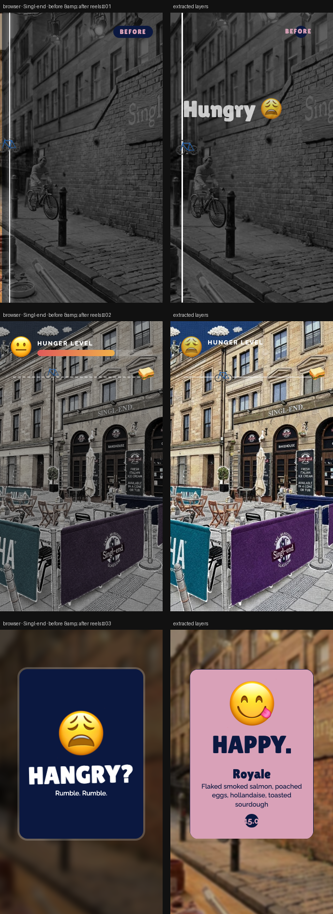

# Singl-end · before & after reels

> Hungry → happy, with a cycling twist. Three 10-second 9:16 loops, each with a different transformation.



**Source:** [`html-examples/Singl-end · before & after reels.html`](../../html-examples/Singl-end · before & after reels.html) · **Stages:** 3 · **Duration:** 10 s  
**Fixture:** [`tests/fixtures/examples/singl-end-before-after-reels.json`](../../tests/fixtures/examples/singl-end-before-after-reels.json) — Chrome at 1080 px, webfonts loaded  
**Layout:** measured in headless Chrome (`--layout measure`)

## Stages

| # | size | duration | layers | text | shapes | photos | text ≤2 % | paint |
|---|---|---|---|---|---|---|---|---|
| 1 | 1080×1920 | 10 s | 15 | 8 | 5 | 2 | 7/8 | 6/6 |
| 2 | 1080×1920 | 10 s | 15 | 10 | 4 | 1 | 7/7 | 4/4 |
| 3 | 1080×1920 | 10 s | 12 | 8 | 3 | 1 | 8/8 | 3/3 |

## How it was extracted

- 3 background layer(s) across all stages — a full-bleed photo with its pan/zoom keyframes, or the stage's own colour/gradient.
- 26 text layer(s) from measured content boxes; font, weight, colour, alignment and letter-spacing come from the computed style, and inline runs are merged into one layer.
- 12 shape layer(s) from background colour, borders, radius and per-side rules.
- 1 separate border rule(s) for borders that only exist on one side.
- 4 photo layer(s) placed at their cover/contain paint box; clipped ones are cropped to the visible window and CSS filters are baked in.
- JS-driven progress variables are set to their resting value before measuring: `--f`, `--k`, `--p`, `--w`.
- Reel length comes from the page's own `D = 10000` constant.
- Stage duration: 10 s; visibility uses the measured `data-s`/`data-e` windows (intersected with ancestors) with instant cuts.

## Design notes

A: a bike emoji “rides” the divider that turns the scene from grey to colour. B: the scene regains colour as the hunger bar drains and the face changes. C: a card flips from hangry to happy over the dimmed street. The bike emoji stands in until the cyclist layer is exportable. Prices and ingredients are from your menu PDF; the Scene 1 sign still reads “Mon–Sun 9–5”.

## Known gaps

- Entry/exit motion (slide, scale, spin) is represented by visibility windows and the background pan, not by the authored transitions.
- Decorative pseudo-elements (dots, halos, halftone overlays) are not measured; textual `::before` content is included.
- Text that the page injects from JS (live clocks, typed lines) is a snapshot from measurement time.

## Warnings

_None._

## Verify

```bash
python3 tools/audit-html-examples.py --only "before & after reels" --no-measure
python3 tools/check-html-parse.py --fixture tests/fixtures/examples/singl-end-before-after-reels.json \
  --html "html-examples/Singl-end · before & after reels.html" --verbose
```

