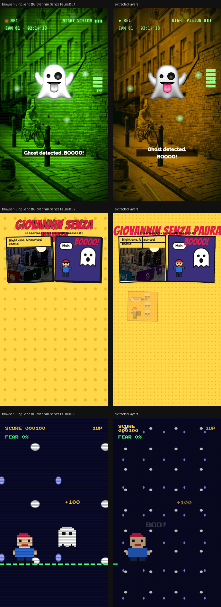

# Singl-end × Giovannin Senza Paura

> Fearless John fears no ghost, skeleton or haunted castle. Three 10-second 9:16 reels play on the one thing that scares him: an empty plate.



**Source:** [`html-examples/Singl-end × Giovannin Senza Paura · reels.html`](../../html-examples/Singl-end × Giovannin Senza Paura · reels.html) · **Stages:** 3 · **Duration:** 10 s  
**Fixture:** [`tests/fixtures/examples/singl-end-giovannin-senza-paura-reels.json`](../../tests/fixtures/examples/singl-end-giovannin-senza-paura-reels.json) — Chrome at 1080 px, webfonts loaded  
**Layout:** measured in headless Chrome (`--layout measure`)

## Stages

| # | size | duration | layers | text | shapes | photos | text ≤2 % | paint |
|---|---|---|---|---|---|---|---|---|
| 1 | 1080×1920 | 10 s | 33 | 17 | 14 | 2 | 11/11 | 11/11 |
| 2 | 1080×1920 | 10 s | 36 | 16 | 15 | 5 | 15/15 | 16/16 |
| 3 | 1080×1920 | 10 s | 26 | 19 | 4 | 3 | 15/15 | 4/4 |

## How it was extracted

- 3 background layer(s) across all stages — a full-bleed photo with its pan/zoom keyframes, or the stage's own colour/gradient.
- 52 text layer(s) from measured content boxes; font, weight, colour, alignment and letter-spacing come from the computed style, and inline runs are merged into one layer.
- 33 shape layer(s) from background colour, borders, radius and per-side rules, including 9 CSS gradient(s) rendered as SVG (linear, radial or tiled).
- 2 separate border rule(s) for borders that only exist on one side.
- 10 photo layer(s) placed at their cover/contain paint box; clipped ones are cropped to the visible window and CSS filters are baked in.
- JS-driven progress variables are set to their resting value before measuring: `--bl`, `--p`.
- Reel length comes from the page's own `D = 10000` constant.
- Stage duration: 10 s; visibility uses the measured `data-s`/`data-e` windows (intersected with ancestors) with instant cuts.

## Design notes

The tale has many versions, but in all of them Giovannin laughs at ghosts and skeletons (the skittles scene comes from the story). The “only an empty plate scares him” joke is mine, so edit it freely. Menu items, prices and ingredients come from your PDF. The night-vision reel reuses your cyclist scene, and the comic’s “castle” is your Merchant City facade, darkened. The Scene 1 sign still says “Mon–Sun 9–5”, so check your hours.

## Known gaps

- Entry/exit motion (slide, scale, spin) is represented by visibility windows and the background pan, not by the authored transitions.
- Decorative pseudo-elements (dots, halos, halftone overlays) are not measured; textual `::before` content is included.
- Text that the page injects from JS (live clocks, typed lines) is a snapshot from measurement time.

## Warnings

_None._

## Verify

```bash
python3 tools/audit-html-examples.py --only "reels" --no-measure
python3 tools/check-html-parse.py --fixture tests/fixtures/examples/singl-end-giovannin-senza-paura-reels.json \
  --html "html-examples/Singl-end × Giovannin Senza Paura · reels.html" --verbose
```

