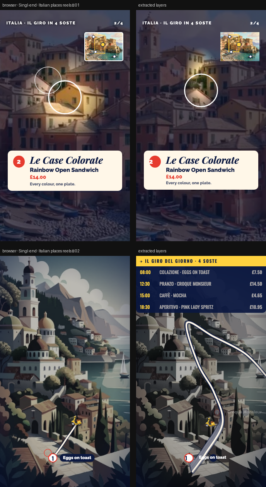

# Singl-end · Italian places

> Two very different 9:16 reels that use animation to highlight places in your images: a spotlight tour (12s) and an animated route with a departures board (10s).



**Source:** [`html-examples/Singl-end · Italian places reels.html`](../../html-examples/Singl-end · Italian places reels.html) · **Stages:** 2 · **Duration:** 10 s, 12 s  
**Fixture:** [`tests/fixtures/examples/singl-end-italian-places-reels.json`](../../tests/fixtures/examples/singl-end-italian-places-reels.json) — Chrome at 1080 px, webfonts loaded  
**Layout:** measured in headless Chrome (`--layout measure`)
**Deep review:** [animation fidelity](../review-italian-places-animation.md)  

## Stages

| # | size | duration | layers | text | shapes | photos | text ≤2 % | paint |
|---|---|---|---|---|---|---|---|---|
| 1 | 1080×1920 | 12 s | 84 | 39 | 43 | 2 | 36/36 | 24/24 |
| 2 | 1080×1920 | 10 s | 48 | 24 | 12 | 12 | 16/16 | 3/3 |

## How it was extracted

- 2 background layer(s) across all stages — a full-bleed photo with its pan/zoom keyframes, or the stage's own colour/gradient.
- 63 text layer(s) from measured content boxes; font, weight, colour, alignment and letter-spacing come from the computed style, and inline runs are merged into one layer.
- 55 shape layer(s) from background colour, borders, radius and per-side rules, including 17 CSS gradient(s) rendered as SVG (linear, radial or tiled).
- 4 separate border rule(s) for borders that only exist on one side.
- 14 photo layer(s) placed at their cover/contain paint box; clipped ones are cropped to the visible window and CSS filters are baked in.
- 11 inline-SVG artwork layer(s), rasterized in Chrome because the drawing cannot be expressed as editable boxes or type.
- JS-driven progress variables are set to their resting value before measuring: `--p`, `--ry`.
- Stage duration: 10 s, 12 s; visibility uses the measured `data-s`/`data-e` windows (intersected with ancestors) with instant cuts.

## Design notes

I labelled the places generically (bell tower, colourful houses, boats, sea, domes, sailboat) since I don’t know the real locations. Rename them if you want to name the town. Pairings are playful (rainbow houses → Rainbow Open Sandwich, boats → Salmon Sandwich) and every price comes from your menu PDF. Please confirm you have usage rights for both images.

## Known gaps

- The camera flight, minimap viewport, active location dot, counter, route and spotlight are sampled from the page's own `f(t)` and emitted as keyframes or flipbook frames; the route (12 frames) and spotlight (16 frames) step rather than move continuously.
- The second pulsing ring and the soft shadows are a `::after` pseudo-element and `box-shadow`, so they are not separate layers.
- The departures board's active row (`.rw.on`) swaps to a gold background; the row container is transparent at rest, so only its text is emitted and the highlight is not.
- The SVG artwork is flattened: its type and illustration are not editable layers, and the stop-motion filters are frozen at the measured frame.
- Decorative pseudo-elements (dots, halos, halftone overlays) are not measured; textual `::before` content is included.
- Text that the page injects from JS (live clocks, typed lines) is a snapshot from measurement time.

## Warnings

_None._

## Verify

```bash
python3 tools/audit-html-examples.py --only "Italian places reels" --no-measure
python3 tools/check-html-parse.py --fixture tests/fixtures/examples/singl-end-italian-places-reels.json \
  --html "html-examples/Singl-end · Italian places reels.html" --verbose
```

