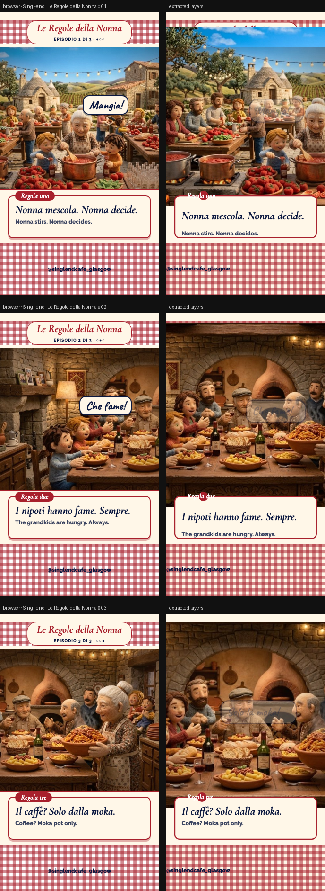

# Le Regole della Nonna

> A three-episode reel series: Nonna’s rules, Nonno’s opinions and one dish per episode. Same template, a camera tour through your two scenes, 10 seconds each, 9:16.



**Source:** [`html-examples/Singl-end · Le Regole della Nonna (3-episode series).html`](../../html-examples/Singl-end · Le Regole della Nonna (3-episode series).html) · **Stages:** 3 · **Duration:** 10 s  
**Fixture:** [`tests/fixtures/examples/singl-end-le-regole-della-nonna-3-episode-series.json`](../../tests/fixtures/examples/singl-end-le-regole-della-nonna-3-episode-series.json) — Chrome at 1080 px, webfonts loaded  
**Layout:** measured in headless Chrome (`--layout measure`)

## Stages

| # | size | duration | layers | text | shapes | photos | text ≤2 % | paint |
|---|---|---|---|---|---|---|---|---|
| 1 | 1080×1920 | 10 s | 34 | 19 | 14 | 1 | 19/19 | 12/12 |
| 2 | 1080×1920 | 10 s | 34 | 19 | 14 | 1 | 19/19 | 12/12 |
| 3 | 1080×1920 | 10 s | 34 | 19 | 14 | 1 | 19/19 | 12/12 |

## How it was extracted

- 3 background layer(s) across all stages — a full-bleed photo with its pan/zoom keyframes, or the stage's own colour/gradient.
- 57 text layer(s) from measured content boxes; font, weight, colour, alignment and letter-spacing come from the computed style, and inline runs are merged into one layer.
- 42 shape layer(s) from background colour, borders, radius and per-side rules, including 9 CSS gradient(s) rendered as SVG (linear, radial or tiled).
- 6 separate border rule(s) for borders that only exist on one side.
- 3 photo layer(s) placed at their cover/contain paint box; clipped ones are cropped to the visible window and CSS filters are baked in.
- 3 text layer(s) include a `::before` glyph (the menu ticks).
- JS-driven progress variables are set to their resting value before measuring: `--p`.
- Reel length comes from the page's own `D = 10000` constant.
- Stage duration: 10 s; visibility uses the measured `data-s`/`data-e` windows (intersected with ancestors) with instant cuts.

## Design notes

The camera glides between characters in your two scenes (the tomato-sauce gathering for episode 1, the family dinner for episodes 2 and 3). The Italian lines and “Nonna approved” stamp are mine, so check them with a native speaker if you can. Menu names, prices and ingredients come from your PDF; the cappuccino joke is brand copy (you do serve it all day). The Scene 1 sign still reads “Mon–Sun 9–5” in the earlier images, so check hours before publishing.

## Known gaps

- The `Regola` badge overlaps the card; stacking is DOM order, so on this page the badge can end up behind the card instead of above it.
- Box shadows (card, badge) are not reproduced.
- Entry/exit motion (slide, scale, spin) is represented by visibility windows and the background pan, not by the authored transitions.
- Decorative pseudo-elements (dots, halos, halftone overlays) are not measured; textual `::before` content is included.
- Text that the page injects from JS (live clocks, typed lines) is a snapshot from measurement time.

## Warnings

_None._

## Verify

```bash
python3 tools/audit-html-examples.py --only "Le Regole della Nonna (3-episode ser" --no-measure
python3 tools/check-html-parse.py --fixture tests/fixtures/examples/singl-end-le-regole-della-nonna-3-episode-series.json \
  --html "html-examples/Singl-end · Le Regole della Nonna (3-episode series).html" --verbose
```

