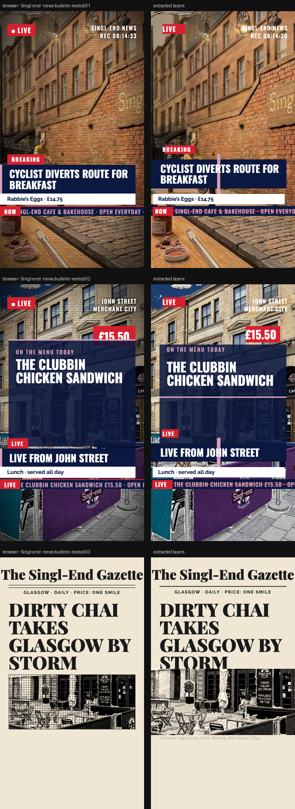

# Singl-end · news bulletins

> Three 10-second 9:16 news-style reels: breaking news, a live field report and a front-page extra.



**Source:** [`html-examples/Singl-end · news bulletin reels.html`](../../html-examples/Singl-end · news bulletin reels.html) · **Stages:** 3 · **Duration:** 10 s  
**Fixture:** [`tests/fixtures/examples/singl-end-news-bulletin-reels.json`](../../tests/fixtures/examples/singl-end-news-bulletin-reels.json) — Chrome at 1080 px, webfonts loaded  
**Layout:** measured in headless Chrome (`--layout measure`)

## Stages

| # | size | duration | layers | text | shapes | photos | text ≤2 % | paint |
|---|---|---|---|---|---|---|---|---|
| 1 | 1080×1920 | 10 s | 26 | 11 | 14 | 1 | 12/12 | 11/11 |
| 2 | 1080×1920 | 10 s | 27 | 15 | 11 | 1 | 15/15 | 8/8 |
| 3 | 1080×1920 | 10 s | 13 | 7 | 5 | 1 | 7/7 | 4/4 |

## How it was extracted

- 3 background layer(s) across all stages — a full-bleed photo with its pan/zoom keyframes, or the stage's own colour/gradient.
- 33 text layer(s) from measured content boxes; font, weight, colour, alignment and letter-spacing come from the computed style, and inline runs are merged into one layer.
- 30 shape layer(s) from background colour, borders, radius and per-side rules.
- 8 separate border rule(s) for borders that only exist on one side.
- 3 photo layer(s) placed at their cover/contain paint box; clipped ones are cropped to the visible window and CSS filters are baked in.
- 5 text layer(s) include a `::before` glyph (the menu ticks).
- JS-driven progress variables are set to their resting value before measuring: `--p`, `--s`.
- Reel length comes from the page's own `D = 10000` constant.
- Stage duration: 10 s; visibility uses the measured `data-s`/`data-e` windows (intersected with ancestors) with instant cuts.

## Design notes

The headlines are tongue-in-cheek brand copy, so edit the wording to suit your voice. Prices and ingredients come from your menu PDF. Scene 1’s sign still reads “Mon–Sun 9–5”, please check hours. The live timecode ticks in real time while the reel plays.

## Known gaps

- The LIVE dot (a pseudo-element) and the scanline/vignette texture are not separate layers; the timecode is a snapshot taken while measuring.
- Entry/exit motion (slide, scale, spin) is represented by visibility windows and the background pan, not by the authored transitions.
- Decorative pseudo-elements (dots, halos, halftone overlays) are not measured; textual `::before` content is included.
- Text that the page injects from JS (live clocks, typed lines) is a snapshot from measurement time.

## Warnings

_None._

## Verify

```bash
python3 tools/audit-html-examples.py --only "news bulletin reels" --no-measure
python3 tools/check-html-parse.py --fixture tests/fixtures/examples/singl-end-news-bulletin-reels.json \
  --html "html-examples/Singl-end · news bulletin reels.html" --verbose
```

