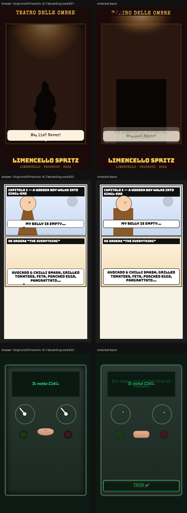

# Singl-end × Pinocchio · ALT reels

> Three completely different visual languages for the same three dishes: a high-contrast shadow-puppet stage, a slamming comic-strip sequence, and a mechanical lie-detector machine. Still 10 s · 9:16.



**Source:** [`html-examples/Singl-end Pinocchio · ALT reels.html`](../../html-examples/Singl-end Pinocchio · ALT reels.html) · **Stages:** 3 · **Duration:** 10 s  
**Fixture:** [`tests/fixtures/examples/singl-end-pinocchio-alt-reels.json`](../../tests/fixtures/examples/singl-end-pinocchio-alt-reels.json) — Chrome at 1080 px, webfonts loaded  
**Layout:** measured in headless Chrome (`--layout measure`)

## Stages

| # | size | duration | layers | text | shapes | photos | text ≤2 % | paint |
|---|---|---|---|---|---|---|---|---|
| 1 | 1080×1920 | 10 s | 18 | 7 | 11 | 0 | 7/7 | 7/7 |
| 2 | 1080×1920 | 10 s | 26 | 8 | 18 | 0 | 8/8 | 17/17 |
| 3 | 1080×1920 | 10 s | 25 | 10 | 15 | 0 | 7/7 | 14/14 |

## How it was extracted

- 3 background layer(s) across all stages — a full-bleed photo with its pan/zoom keyframes, or the stage's own colour/gradient.
- 25 text layer(s) from measured content boxes; font, weight, colour, alignment and letter-spacing come from the computed style, and inline runs are merged into one layer.
- 44 shape layer(s) from background colour, borders, radius and per-side rules, including 8 CSS gradient(s) rendered as SVG (linear, radial or tiled).
- 2 text layer(s) include a `::before` glyph (the menu ticks).
- JS-driven progress variables are set to their resting value before measuring: `--p`.
- Reel length comes from the page's own `D = 10000` constant.
- Stage duration: 10 s; visibility uses the measured `data-s`/`data-e` windows (intersected with ancestors) with instant cuts.

## Design notes

Same three dishes and prices as the original Pinocchio set, completely different visual systems. A uses pure CSS silhouettes and a growing nose shadow under a theatre light. B is a three-panel comic that slams in with ink splatters. C is a mechanical lie-detector with swinging needles, coloured lamps and a physical nose that lengthens on the lie. All timings stay ~10 seconds for easy screen-recording.

## Known gaps

- The shadow-puppet and comic-strip reels rely on hard shadows and clip wipes; box shadows and `clip-path` wipes are not separate layers, so the wipe is a visibility window.
- Decorative pseudo-elements (dots, halos, halftone overlays) are not measured; textual `::before` content is included.
- Text that the page injects from JS (live clocks, typed lines) is a snapshot from measurement time.

## Warnings

_None._

## Verify

```bash
python3 tools/audit-html-examples.py --only "ALT reels" --no-measure
python3 tools/check-html-parse.py --fixture tests/fixtures/examples/singl-end-pinocchio-alt-reels.json \
  --html "html-examples/Singl-end Pinocchio · ALT reels.html" --verbose
```

