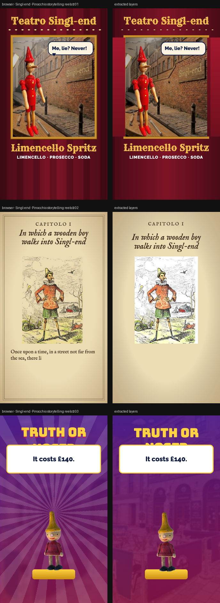

# Singl-end × Pinocchio

> Three very different Italian-storytelling reels: a puppet theatre, an illustrated storybook and a lie-detector game show. 10 seconds each, 9:16.



**Source:** [`html-examples/Singl-end × Pinocchio · storytelling reels.html`](../../html-examples/Singl-end × Pinocchio · storytelling reels.html) · **Stages:** 3 · **Duration:** 10 s  
**Fixture:** [`tests/fixtures/examples/singl-end-pinocchio-storytelling-reels.json`](../../tests/fixtures/examples/singl-end-pinocchio-storytelling-reels.json) — Chrome at 1080 px, webfonts loaded  
**Layout:** measured in headless Chrome (`--layout measure`)

## Stages

| # | size | duration | layers | text | shapes | photos | text ≤2 % | paint |
|---|---|---|---|---|---|---|---|---|
| 1 | 1080×1920 | 10 s | 20 | 7 | 11 | 2 | 7/7 | 7/7 |
| 2 | 1080×1920 | 10 s | 10 | 7 | 2 | 1 | 7/7 | 2/2 |
| 3 | 1080×1920 | 10 s | 25 | 11 | 12 | 2 | 11/11 | 10/10 |

## How it was extracted

- 3 background layer(s) across all stages — a full-bleed photo with its pan/zoom keyframes, or the stage's own colour/gradient.
- 25 text layer(s) from measured content boxes; font, weight, colour, alignment and letter-spacing come from the computed style, and inline runs are merged into one layer.
- 25 shape layer(s) from background colour, borders, radius and per-side rules, including 11 CSS gradient(s) rendered as SVG (linear, radial or tiled).
- 5 photo layer(s) placed at their cover/contain paint box; clipped ones are cropped to the visible window and CSS filters are baked in.
- 2 text layer(s) include a `::before` glyph (the menu ticks).
- JS-driven progress variables are set to their resting value before measuring: `--f`, `--n`, `--p`, `--u`, `--z`.
- Reel length comes from the page's own `D = 10000` constant.
- Stage duration: 10 s; visibility uses the measured `data-s`/`data-e` windows (intersected with ancestors) with instant cuts.

## Design notes

A: the nose grows when he fibs, then shrinks as he tells the truth. B: a page-turn storybook with your Chiostri illustration blended into parchment. C: the nose swells on every lie. All dishes, prices and ingredients are from your menu PDF (the Italian touches are the Limencello Spritz and the Everything’s pangrattato). Pinocchio’s story is long out of copyright, but please confirm you hold the right to use the toy and illustration photos you sent. The Scene 1 sign still reads “Mon–Sun 9–5”.

## Known gaps

- The curtain halves are gradient layers and the progress-driven overlays sit at their resting position; their entrance timing is not keyframed.
- The theatre-window photo can overpaint its gold frame when it is transformed inside a window that does not clip its content.
- Some gradient overlays could not be reproduced and were skipped (see the warnings below).
- Entry/exit motion (slide, scale, spin) is represented by visibility windows and the background pan, not by the authored transitions.
- Decorative pseudo-elements (dots, halos, halftone overlays) are not measured; textual `::before` content is included.
- Text that the page injects from JS (live clocks, typed lines) is a snapshot from measurement time.

## Warnings

> Stage 3: Gradient on <div .abs sb> is not supported; skipped.

## Verify

```bash
python3 tools/audit-html-examples.py --only "storytelling reels" --no-measure
python3 tools/check-html-parse.py --fixture tests/fixtures/examples/singl-end-pinocchio-storytelling-reels.json \
  --html "html-examples/Singl-end × Pinocchio · storytelling reels.html" --verbose
```

