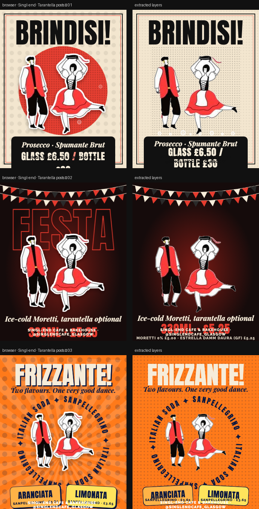

# Singl-end · Tarantella posts

> Three stylish 4:5 feed posts built around your Italian folk dancers, with gentle looping motion. Take a screenshot for a static version.



**Source:** [`html-examples/Singl-end · Tarantella posts.html`](../../html-examples/Singl-end · Tarantella posts.html) · **Stages:** 3 · **Duration:** 10 s  
**Fixture:** [`tests/fixtures/examples/singl-end-tarantella-posts.json`](../../tests/fixtures/examples/singl-end-tarantella-posts.json) — Chrome at 1080 px, webfonts loaded  
**Layout:** measured in headless Chrome (`--layout measure`)

## Stages

| # | size | duration | layers | text | shapes | photos | text ≤2 % | paint |
|---|---|---|---|---|---|---|---|---|
| 1 | 1080×1350 | 10 s | 19 | 4 | 13 | 2 | 5/5 | 14/14 |
| 2 | 1080×1350 | 10 s | 9 | 5 | 1 | 3 | 5/5 | 2/2 |
| 3 | 1080×1350 | 10 s | 13 | 7 | 3 | 3 | 7/8 | 4/4 |

## How it was extracted

- 3 background layer(s) across all stages — a full-bleed photo with its pan/zoom keyframes, or the stage's own colour/gradient.
- 16 text layer(s) from measured content boxes; font, weight, colour, alignment and letter-spacing come from the computed style, and inline runs are merged into one layer.
- 17 shape layer(s) from background colour, borders, radius and per-side rules, including 4 CSS gradient(s) rendered as SVG (linear, radial or tiled).
- 8 photo layer(s) placed at their cover/contain paint box; clipped ones are cropped to the visible window and CSS filters are baked in.
- 2 inline-SVG artwork layer(s), rasterized in Chrome because the drawing cannot be expressed as editable boxes or type.
- Stage duration: 10 s; visibility uses the measured `data-s`/`data-e` windows (intersected with ancestors) with instant cuts.

## Design notes

Important: the dancer artwork you attached is a Shutterstock preview (image ID 1724353873). I cut out just the two dancers here to design the layouts, but you’ll need a licensed copy of that illustration (ideally the vector file) before publishing anything. The layouts will drop in with a clean version. Prices come from your menu PDF; the taglines are my own copy.

## Known gaps

- The outlined display type (`FESTA`), the halftone dot texture and the circle backdrop are not reproduced as layers, so those areas fall back to the plain background.
- The price caption wraps into more lines than the browser's, because the text layer gets a width slack the original shrink-to-fit box did not have.
- The SVG artwork is flattened: its type and illustration are not editable layers, and the stop-motion filters are frozen at the measured frame.
- Some gradient overlays could not be reproduced and were skipped (see the warnings below).
- Entry/exit motion (slide, scale, spin) is represented by visibility windows and the background pan, not by the authored transitions.
- Decorative pseudo-elements (dots, halos, halftone overlays) are not measured; textual `::before` content is included.
- Text that the page injects from JS (live clocks, typed lines) is a snapshot from measurement time.

## Warnings

> Stage 3: Gradient on <div .abs sb> is not supported; skipped.

## Verify

```bash
python3 tools/audit-html-examples.py --only "Tarantella posts" --no-measure
python3 tools/check-html-parse.py --fixture tests/fixtures/examples/singl-end-tarantella-posts.json \
  --html "html-examples/Singl-end · Tarantella posts.html" --verbose
```

