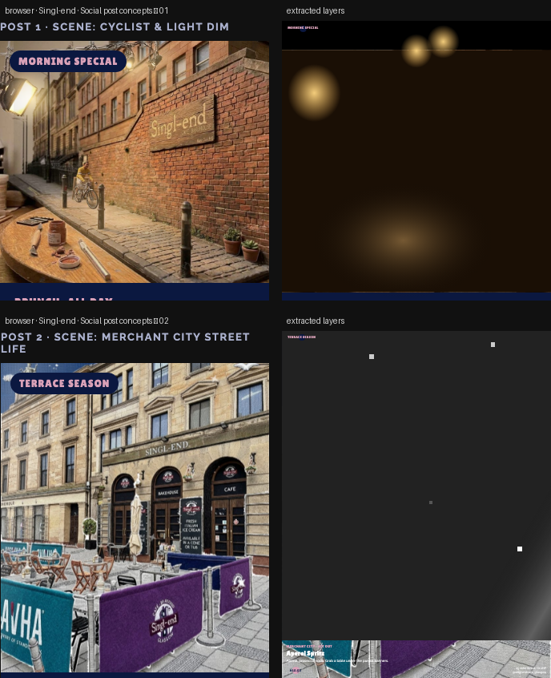

# Singl-end · two post concepts

> Your two scenes as animated 4:5-style feed posts / reel openers, each featuring one menu item. Motion is recreated in CSS from your animation timelines (light dim, sparkle, shine).



**Source:** [`html-examples/Singl-end · two social post concepts.html`](../../html-examples/Singl-end · two social post concepts.html) · **Stages:** 2 · **Duration:** 10 s  
**Fixture:** [`tests/fixtures/examples/singl-end-two-social-post-concepts.json`](../../tests/fixtures/examples/singl-end-two-social-post-concepts.json) — Chrome at 1080 px, webfonts loaded  
**Layout:** measured in headless Chrome (`--layout measure`)

## Stages

| # | size | duration | layers | text | shapes | photos | text ≤2 % | paint |
|---|---|---|---|---|---|---|---|---|
| 1 | 1080×1122 | 10 s | 16 | 6 | 9 | 1 | 6/6 | 5/5 |
| 2 | 1080×1392 | 10 s | 15 | 6 | 8 | 1 | 6/6 | 3/3 |

## How it was extracted

- 2 background layer(s) across all stages — a full-bleed photo with its pan/zoom keyframes, or the stage's own colour/gradient.
- 12 text layer(s) from measured content boxes; font, weight, colour, alignment and letter-spacing come from the computed style, and inline runs are merged into one layer.
- 17 shape layer(s) from background colour, borders, radius and per-side rules, including 5 CSS gradient(s) rendered as SVG (linear, radial or tiled).
- 2 photo layer(s) placed at their cover/contain paint box; clipped ones are cropped to the visible window and CSS filters are baked in.
- Stage duration: 10 s; visibility uses the measured `data-s`/`data-e` windows (intersected with ancestors) with instant cuts.

## Design notes

Flags for you: (1) the sign in Scene 1 reads “Mon–Sun 9–5”, please confirm that matches real hours; the menu only says “open everyday”. (2) Scene 2’s chalkboard promotes Italian ice cream, which isn’t on the menu PDF, so it makes a good third post if you add it. (3) Your JSONs reference separate cut-out layers (cyclist, banners) stored on your tool, not in the files, so I used the flat PNGs; with the layers we can animate the cyclist riding across.

## Known gaps

- Entry/exit motion (slide, scale, spin) is represented by visibility windows and the background pan, not by the authored transitions.
- Decorative pseudo-elements (dots, halos, halftone overlays) are not measured; textual `::before` content is included.
- Text that the page injects from JS (live clocks, typed lines) is a snapshot from measurement time.

## Warnings

_None._

## Verify

```bash
python3 tools/audit-html-examples.py --only "two social post concepts" --no-measure
python3 tools/check-html-parse.py --fixture tests/fixtures/examples/singl-end-two-social-post-concepts.json \
  --html "html-examples/Singl-end · two social post concepts.html" --verbose
```

