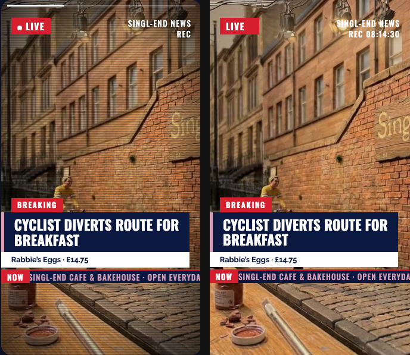
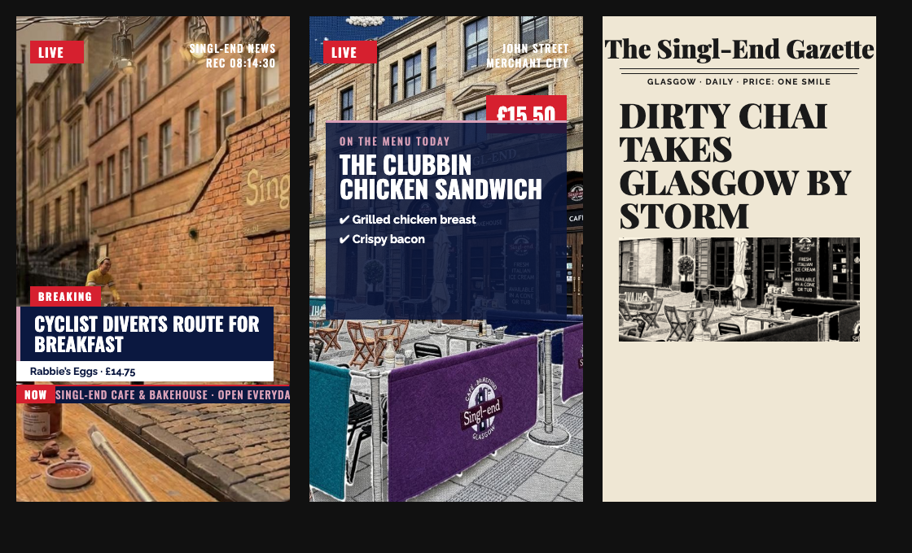

# HTML → LayerStudio pipeline (measured layout)

**Status:** implemented 2026-11-08, after the fidelity review in
[review-news-bulletin-fidelity.md](review-news-bulletin-fidelity.md).
**Acceptance set:** all 20 pages in `html-examples/` — per-page inventory, accuracy and
known gaps are in [examples/](examples/README.md).
**Reference example:** `html-examples/Singl-end · news bulletin reels.html`
(3 reels, 10 s each, 66 measured elements).



Left: the page in Chrome at t = 3 s. Right: the layers `html-to-projects.py` wrote, rendered
from the composition data. Background pan, badges, panels, type and ticker line up.

---

## 1. What changed

The old extractor re-implemented a subset of CSS without a layout engine. It could not see
shrink-to-fit boxes, padding, bottom/right anchoring, content heights, line wrapping,
clipping, or the `.on` state that these reels use for their resting geometry. On this page
33 of 34 text layers were outside a 1 % tolerance and 24 layers were emitted at
`opacity: 0` (invisible in the composition).

The extractor is now **measurement-first**:

1. Parse the HTML as before (stage discovery, duration hints, fallback rules).
2. Render the page in headless Chrome and **measure** every element in the state the viewer
   sees.
3. Build layers from those numbers.
4. Fall back to the CSS walk only when Chrome is unavailable — and say so on the stage.

| | before | after |
|---|---|---|
| Text layers within 2 % of Chrome on every edge | 1 / 34 | **34 / 34** (max delta 0 %) |
| Layers emitted at `opacity < 0.05` | 6 / 12 / 6 | **0 / 0 / 0** |
| Layers outside the stage | 16 / 12 / 2 | 0 (background + marquee overflow by design) |
| Composition duration | 99 s (a `data-e="99"` sentinel) | **10 s** per stage |
| Stage 3 background | the photo | **paper `#efe7d4`** with the photo in its window |
| Timer/clock text | missing | captured |

---

## 2. How it works

### 2.1 Three measurement passes

`tools/measure-html-chrome.py` loads the page in Chrome, waits for `document.fonts.ready`,
adds `.on` to every `[data-s]` element, disables transitions/animations, and records for
every element inside each stage:

* border box, content box, text range box (all in % of the stage),
* nearest clipping ancestor and whether it cuts the element,
* computed typography (`font-size`, family, weight, line-height, letter-spacing, case,
  alignment, colour), background colour/image/position/size, borders per side, radius,
  opacity, transform matrix, filter, `display`/`visibility`,
* direct text, inline-run text, `::before` content, `data-s`/`data-e` and the effective
  window (intersected with all ancestors).

The extractor runs it three times:

| pass | CSS vars | transforms | used for |
|---|---|---|---|
| `start` | `--p=0 --s=1` | on | where the photo sits at t = 0 |
| `end` | `--p=1 --s=1` | on | where the photo sits at t = duration |
| `layout` | `--p=1 --s=1` | **off** | unrotated boxes, content boxes, text boxes |

Passes run at `--stage-width 1080` so that `cqw` values, font sizes and snapped border
widths are exactly the composition's. Percentages are then width-independent, but text
wraps and borders match the exported 1080 × 1920 canvas instead of the ~336 px card in the
example page's grid.

### 2.2 Building layers

`build_stage_measured()` walks the measured nodes in DOM order (paint order):

| element | layer |
|---|---|
| full-bleed background photo | `html-bg`, `fit: fill`, box = the *cover paint box* at p = 0, keyframed to p = 1 → reproduces the authored `background-position`/`scale` pan |
| stage background colour | `html-bg`, solid SVG |
| other `background-image` | image layer at its cover/contain paint box; if clipped, the visible crop is cut with Pillow into a PNG |
| `` | image layer, `object-fit` → paint box |
| background colour / border / radius | shape layer (SVG), plus separate bars for per-side borders (e.g. `.hd`'s pink left rule) |
| element with text | text layer at the **content box** (padding-inset), computed font/colour/alignment, inline runs merged, `::before` glyphs prepended |

Special cases handled for this page family:

* **inline runs** — `SINGL-END NEWS<br>REC <span class=tc>08:14:30</span>` becomes one
  right-aligned text layer instead of two overlapping ones.
* **marquee** — the duplicated ticker string is de-duplicated; the line keeps its real
  (455 %) width so it clips at the stage edge instead of wrapping.
* **CSS filters** — `grayscale(1) contrast(1.35) sepia(.35)` on the newspaper photo is
  applied to the cropped bitmap.
* **width slack** — shrink-to-fit boxes sit exactly on the wrap boundary; text layers get
  1 % extra width (anchored by alignment) so the renderer does not break a line the browser
  fitted.
* **`.on`** — the resting state, not the entry state. Anything the page hides until
  `data-s` is measured as visible.
* **skips** — progress bar, safe-zone guides, loop blackout, scanline/vignette overlay,
  and transparent wrappers.

### 2.3 Timing and duration

* Visibility uses the measured window (`data-s` → `data-e`, intersected with ancestors),
  with **instant** cuts; the old blanket 300 ms fade is gone.
* Ends at or beyond the reel length are treated as open (that is what `data-e="99"` means).
* Stage duration: `data-d` → page constant (`const D = 10000`) → last real `data-e` →
  the UI's *Duration (s, fallback)* value.
* The composition writes the **stage** duration, and the layer keyframes are built against
  it.
* The stage background keyframes animate the photo envelope between the p = 0 and p = 1
  paint boxes, so the pan/zoom plays in the composition and in the preview.

### 2.4 Complex artwork and CSS gradients

Some pages cannot be rebuilt as editable boxes:

* **CSS gradients** (`linear-gradient`, `radial-gradient`, `repeating-linear-gradient`,
  including hard stops and tiled `background-size`) are converted to SVG gradients. This is
  what reproduces the Nonna gingham header/footer and the Italian-places spotlight/vignette.
* **Full-bleed gradient overlays** (spotlight, vignette, shine) are emitted as overlay layers
  instead of being skipped, so the stage keeps its designed contrast.
* **Inline SVG artwork** (Melano’s felt-and-clay scenes, decorative SVGs on Tarantella and
  Italian places) is rasterized in Chrome by `tools/rasterize-html-chrome.py` and emitted as
  one flattened image layer. Its text is part of the raster. The raster is JPEG when the
  element is opaque and PNG when it needs transparency.
* **JS progress variables** (`--p`, `--u`, `--s`, …) are detected from the stage's custom
  properties, set to `0` for the start pass and `1` for the resting passes, so products that
  rise into frame (`--u`) or pages that slide (`--p`) are measured where the viewer sees them.
* **Image placement** picks the state that is actually on stage (entry transforms can start
  off-canvas, exit transforms can end off-canvas), then clips to the element box and the
  nearest clipping ancestor; the visible crop is cut with Pillow and CSS filters applied.
* **Background sizing** honours `cover`, `contain`, `fill`, `none`, px and `%` pairs (e.g.
  `260% auto`), and filter chains include `blur`, `saturate`, `brightness`, `contrast`,
  `grayscale` and `sepia`.
* **Rounded clip windows** (`border-radius` on an `overflow:hidden` ancestor, e.g. the arch
  window in the minimalist reels or the minimap frame) are masked per corner, so the photo
  keeps the designed arch/round shape.

### 2.5 Animation (time sampling)

Static layers cannot express a camera flight or a route that draws itself. When the page
exposes its own frame function (`f(t)` in the Italian places and Heritage pages), the
harness takes **16 samples across the reel** and records every node's box, content box,
effective opacity, text, colour and resolved background. From those samples the extractor
builds:

* **box/opacity keyframes** for the camera photo, the minimap viewport rectangle, cards,
  the Scooter and the pins/captions (which are invisible at rest but appear mid-reel);
* **text variants** for counters (`1/4` … `4/4`), each with its own window;
* **state variants** for the active location dot (colour and scale);
* **flipbook frames** for an SVG whose `stroke-dashoffset` changes (the route draws in
  14 frames) and for a gradient whose centre moves (the spotlight follows the camera in
  16 gradient frames).

Pages without a frame function are sampled by setting `--p`/`.on` per time, so
progress-driven pages get the same treatment. Only **top-level** stages are used; a
miniature stage nested inside a postcard rack is not treated as a reel.

**Video.** `<video>` elements (including the base64/blob MP4s on the video-posts page) are
captured as a poster frame after the video reaches `readyState >= 2` and emitted as an image
layer; the overlays are keyframed from the page's own video timeline. Video motion and audio
are not part of the layer composition. The comparison renderer advances the *truth*
page to the same absolute time, so both sides show the same moment. A worked example is
[review-italian-places-animation.md](review-italian-places-animation.md).

### 2.6 CSS fallback

Chrome is optional. `--layout auto` (default) measures when possible; `--layout css` forces
the old path; `--layout measure` fails if Chrome is missing. The fallback gained the cheap
wins from the review:

* `.on` variants are applied when computing styles (resting state),
* `bottom`/`right` are resolved against the box size,
* right-anchored text gets an intrinsic-width estimate instead of the parent's width,
* a photo is only the stage background when it is positioned against the stage,
* stage duration / sentinel handling is shared,
* every stage is labelled `layout: css-estimated` with a warning.

Fallback output is approximate; the UI prints **estimated** on those cards.

---

## 3. Verification

```bash
# ground truth snapshot (already committed)
python3 tools/measure-html-chrome.py \
  --html "html-examples/Singl-end · news bulletin reels.html" \
  --state on --var p=1 --var s=1 --stage-width 1080 --no-transform \
  --out tests/fixtures/news-bulletins-chrome-boxes.json

# score the extractor against it (regenerates the preview internally)
python3 tools/check-html-parse.py \
  --fixture tests/fixtures/news-bulletins-chrome-boxes.json \
  --html "html-examples/Singl-end · news bulletin reels.html" --verbose
```

Current score:

```
stage   text found in tol dim<.05 outside      ms  max delta
    1     12    12     12       0       0   10000    0.00%
    2     15    15     15       0       0   10000    0.00%
    3      7     7      7       0       0   10000    0.00%

text layers within 2% on all edges: 34/34
```



`check-html-parse.py --strict` is the acceptance gate. It compares text layers with the
element's content box (what a text layer uses), treats merged inline runs as covered by
their container layer, and ignores intentional overflow (background envelopes, the ticker
line).

All **20** example pages score **100 % painted-box coverage** (the six newest pages
included). Text runs are within 2 % of the browser except a few documented cases: the
Melano page, whose copy lives inside the SVG artwork and is baked (`0/16 (baked)`); one
emoji glyph on the before/after page; the Tarantella price caption, whose shrink-to-fit line
wraps differently; and one postcard caption on the ALT places rack. Each report links its fixture, its browser-vs-extracted image and
its remaining approximations.

Every example report is regenerated with:

```bash
python3 tools/audit-html-examples.py -o docs/examples/_audit.json
python3 tools/build-example-docs.py
```

Tests: `python3 -m unittest tests.test_html_layout -v` — duration/sentinel rules, hard-cut
keyframes, marquee de-duplication, background selection, the CSS fallback, the Chrome
measured path, and the composition write. Chrome-dependent tests skip when no Chrome is
installed. The fixture records the page sha256, so a changed example fails the test with a
"regenerate the fixture" message instead of silently drifting.

---

## 4. Requirements and behaviour

* **Chrome/Chromium** for measured layout (auto-detected; `--no-sandbox` and legacy
  `--headless` are retried automatically).
* **Webfonts** are awaited. If they do not load, a warning is printed because text boxes may
  re-wrap in Studio.
* **Cost:** three Chrome launches per parse (~5–7 s for a 3-stage page), once for the
  preview and once for generation.
* **Page assumptions:** stages are `.stage/.post/.reel/.story`; the reveal class is `.on`;
  progress is driven by `--p`/`--s` (or none). Pages that animate differently still get
  correct geometry; only their entry motion is approximated.
* **JS-built stages** are supported: the rendered stage count (not the static HTML) drives
  extraction, and the page's own scripts are left running (with `requestAnimationFrame`
  stubbed) so template-generated stages exist for measurement and rasterization.
* **Stage-level backgrounds** are honoured: a stage gradient (`linear-gradient(var(--b1),var(--b2))`
  with inline variables) becomes the backdrop, and a rendered `data-d` overrides the detected
  duration (used by the Heritage Collection pages).

---

## 5. Known gaps (next pass)

1. **Entry motion.** Layers appear at their `data-s` with correct geometry but without the
   authored slide/scale/spin (`.sl { translateX(-110%) }`, `.bk { scale(1.6) }`, the
   newspaper spin-in). The keyframes encode visibility and the background pan only. This is
   the largest remaining visual gap.
2. **Decorative pseudo-elements.** Textual `::before` content (the menu ticks) is included;
   purely decorative ones (the white dot in the LIVE badge) are not measured and are
   missing.
3. **Gradients and overlays.** Scanlines, vignette, halftone dots, the progress bar and the
   loop blackout are skipped (progress/safe zones intentionally; the rest is a warning).
4. **Marquee animation.** The ticker is a static, de-duplicated first frame, not a scroll.
5. **Clip-path reveal.** `.ph`'s wipe-in is captured at its open state.
6. **Dynamic text.** JS-injected copy (the timecode) is a snapshot from parse time.
7. **Light theme only.** `prefers-color-scheme` variants are not parsed.
8. **Pseudo colour.** The menu ticks are rendered in the text colour, not the authored pink.
9. **Stacking order** is DOM order; `z-index` is recorded but not applied, so a badge that
   overlaps a card can end up behind it on pages that rely on explicit z-index.
10. **`clip-path` reveals** are captured at their open state; the wipe animation is not
    keyframed (the *shape* of rounded clips is preserved, see above).
11. **Flattened artwork** (Melano) is one image layer: faithful, but not editable type or
    illustration, and its stop-motion filter is frozen at the measured frame.

Each of these is cosmetic relative to the layer geometry, which is now measured rather than
guessed.

---

## 6. Files

| file | role |
|---|---|
| `tools/measure-html-chrome.py` | headless-Chrome measurement harness (3 pass types, clipping, text boxes, inline runs, filters metadata) |
| `tools/html-to-projects.py` | extractor: measured backend, CSS fallback, duration/timing, composition |
| `tools/check-html-parse.py` | scores the extractor against a Chrome fixture |
| `tools/measure-html-chrome.py --samples N` | time-sampled state for animation keyframes |
| `tools/audit-html-examples.py` | measures every example, matches text runs and painted boxes to layers, reports gaps |
| `tools/rasterize-html-chrome.py` | isolates and rasterizes one element (transparent PNG) for SVG artwork |
| `tools/render-html-example.py` | browser-vs-extracted comparison images used by the reports |
| `tools/build-example-docs.py` | writes `docs/examples/*.md` from the audit + previews |
| `docs/examples/` | per-example reports: inventory, accuracy, specifics, gaps |
| `tests/fixtures/news-bulletins-chrome-boxes.json` | ground truth for the acceptance page |
| `tests/test_html_layout.py` | unit + end-to-end tests |
| `html-to-layers.html` | per-stage duration, measured/estimated badge, composition link |
| `image-to-layers-server.py` | forwards `durationMs` and `fetchRemote` to the CLI |
| `docs/review-news-bulletin-fidelity.md` | the original review (historical) |
